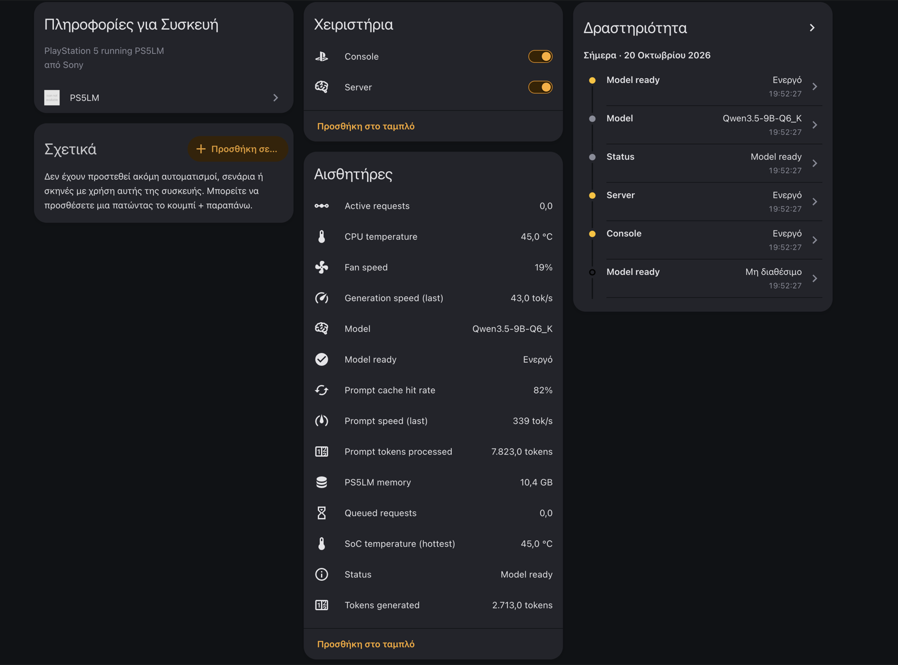
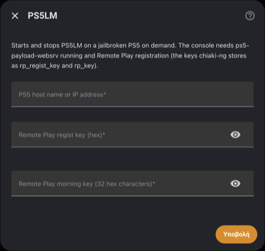
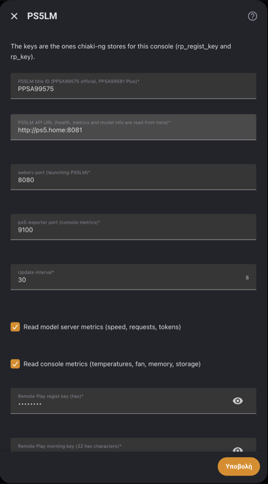
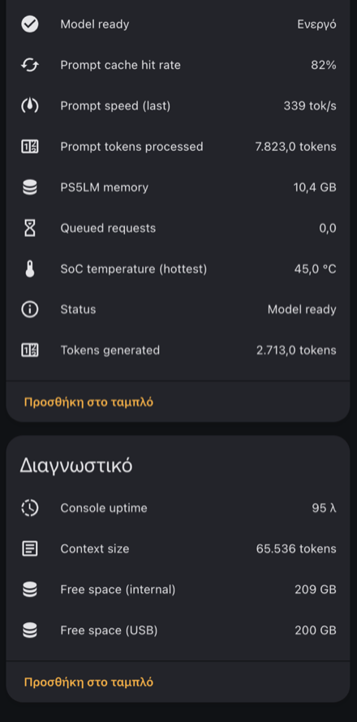

[](https://github.com/phoinixgrr/ps5lm_ha/actions/workflows/hacs-validation.yml)
[](https://github.com/phoinixgrr/ps5lm_ha/actions/workflows/hassfest-validation.yaml)
[](https://github.com/phoinixgrr/ps5lm_ha/actions/workflows/tests.yml)

# 

On-demand local LLM inference on a PS5.

[PS5LM](https://github.com/cobanov/PS5LM) runs llama.cpp on the GPU of a jailbroken PS5 and serves an OpenAI-compatible API (about 45 tok/s on Qwen 3.5 9B Q6_K). Keeping a console on all day for that wastes power and makes noise. This integration starts it when you need it and sends it back to rest mode when you are done.



## What it does

- Wakes the PS5 from rest mode, signs the user in, starts PS5LM and waits until the model is loaded (about 2 minutes)
- Stops PS5LM, or puts the whole console back to rest mode
- Exposes PS5LM and console metrics as sensors
- Everything is a switch or a service, so automations can do it

## How it works

1. Wake packet over the Remote Play discovery port (UDP 9302)
2. A Remote Play control connection signs the user in. A console woken from rest mode sits at the "press the PS button" screen and cannot launch apps until someone is signed in.
3. [ps5-payload-websrv](https://github.com/ps5-payload-dev/websrv) launches PS5LM
4. PS5LM's `/health` is polled until the model answers
5. Rest mode is sent as a Remote Play control message

No cloud and no extra Python packages. The Remote Play part is a small Python re-implementation of what [chiaki-ng](https://github.com/streetpea/chiaki-ng) does; chiaki-ng is only needed once, to register the console.

## Requirements

- A jailbroken PS5 with etaHEN, PS5LM and ps5-payload-websrv (port 8080)
- The console registered for Remote Play in chiaki-ng
- On the PS5: **Enable Turning On PS5 from Network** (Settings > System > Power Saving > Features Available in Rest Mode) and **Log In to PS5 Automatically** (Settings > Users and Accounts > Login Settings)

## Installation

HACS: add `https://github.com/phoinixgrr/ps5lm_ha` as a custom repository (category Integration), install **PS5LM**, restart.

Manual: copy `custom_components/ps5_launcher/` to your `custom_components/` and restart.

## Configuration

1. Get the Remote Play keys from chiaki-ng: `python3 tools/chiaki_keys.py`
2. **Settings > Devices & Services > Add Integration > PS5LM**: enter the PS5 host and the two keys

   

3. The second screen has defaults for everything; change them only if your setup differs

| Option | Default |
|---|---|
| PS5LM title ID | `PPSA99575` (`PPSA99581` for PS5LM Plus) |
| PS5LM API URL | `http://<host>:8081` |
| websrv port | `8080` |
| ps5-exporter port | `9100` |
| Update interval | `30 s` |
| Console metrics interval | `120 s` |
| Model server / console metrics | on |

Everything except the host can be changed later under **Configure**.



## Entities

| Entity | |
|---|---|
| **Console** switch | on = awake, off = rest mode |
| **Server** switch | on = start PS5LM (wakes the console if needed), off = stop PS5LM |
| **Status** | Rest mode, Waking the console, Signing in, Starting PS5LM, Loading the model, Model ready, ... |
| **Model ready** | PS5LM answers its health check |
| Model metrics | model, context size, generation and prompt speed, active and queued requests, token counters, prompt cache hit rate |
| Console metrics | CPU and SoC temperature, fan speed, PS5LM memory, uptime, free space |



Services: `ps5_launcher.wake`, `ps5_launcher.standby`, `ps5_launcher.start_app`, `ps5_launcher.stop_app`.

## Automations

Entity IDs below are for a console added as `ps5.home`; check yours on the device page. Replace `notify.notify` and the conversation agent with your own.

### Ready on demand

A script other automations can call: starts PS5LM if needed and returns once the model answers (fails after 5 minutes).

```yaml
script:
  ps5lm_ready:
    alias: PS5LM ready
    mode: queued
    sequence:
      - action: switch.turn_on
        target:
          entity_id: switch.ps5lm_ps5_home_server
      - wait_template: "{{ is_state('binary_sensor.ps5lm_ps5_home_model_ready', 'on') }}"
        timeout: "00:05:00"
        continue_on_timeout: false
```

### Ask the model, then sleep again

Wakes the console, asks the local model, sends the answer, and puts the console back to rest mode only if it was asleep before.

```yaml
- alias: PS5LM morning briefing
  triggers:
    - trigger: time
      at: "07:30:00"
  actions:
    - variables:
        was_asleep: "{{ is_state('switch.ps5lm_ps5_home_console', 'off') }}"
    - action: script.ps5lm_ready
    - action: conversation.process
      data:
        agent_id: conversation.your_ps5lm_agent
        text: "Two short lines: today's weather and anything in the house that needs attention."
      response_variable: answer
    - action: notify.notify
      data:
        title: Good morning
        message: "{{ answer.response.speech.plain.speech }}"
    - if: "{{ was_asleep }}"
      then:
        - action: switch.turn_off
          target:
            entity_id: switch.ps5lm_ps5_home_console
```

### Rest mode when idle

One hour after the last generated token. A fixed time would cut off a running chat; this waits until nothing has happened for an hour.

```yaml
- alias: PS5LM idle to rest mode
  triggers:
    - trigger: state
      entity_id: sensor.ps5lm_ps5_home_tokens_generated
      for: "01:00:00"
  conditions:
    - condition: state
      entity_id: switch.ps5lm_ps5_home_console
      state: "on"
  actions:
    - action: switch.turn_off
      target:
        entity_id: switch.ps5lm_ps5_home_console
```

### Rest mode when nobody is home

```yaml
- alias: PS5LM off when the house is empty
  triggers:
    - trigger: numeric_state
      entity_id: zone.home
      below: 1
      for: "00:15:00"
  conditions:
    - condition: state
      entity_id: switch.ps5lm_ps5_home_console
      state: "on"
  actions:
    - action: switch.turn_off
      target:
        entity_id: switch.ps5lm_ps5_home_console
```

### Overheat protection

Stops PS5LM if the hottest SoC sensor stays above 85 °C, and tells you.

```yaml
- alias: PS5LM too hot
  triggers:
    - trigger: numeric_state
      entity_id: sensor.ps5lm_ps5_home_soc_temperature_hottest
      above: 85
      for: "00:02:00"
  actions:
    - action: switch.turn_off
      target:
        entity_id: switch.ps5lm_ps5_home_server
    - action: notify.notify
      data:
        message: >-
          PS5LM stopped: SoC at {{ states('sensor.ps5lm_ps5_home_soc_temperature_hottest') }} °C,
          fan {{ states('sensor.ps5lm_ps5_home_fan_speed') }} %.
```

### Ready and failure alerts

```yaml
- alias: PS5LM model ready
  triggers:
    - trigger: state
      entity_id: binary_sensor.ps5lm_ps5_home_model_ready
      from: "off"
      to: "on"
  actions:
    - action: notify.notify
      data:
        message: "{{ states('sensor.ps5lm_ps5_home_model') }} is ready."

- alias: PS5LM start or stop failed
  triggers:
    - trigger: state
      entity_id: sensor.ps5lm_ps5_home_status
      attribute: last_result
  conditions:
    - "{{ (trigger.to_state.attributes.last_result or '').startswith('failed') }}"
  actions:
    - action: notify.notify
      data:
        message: "PS5LM: {{ trigger.to_state.attributes.last_result }}"
```

## Notes

- Tested with PS5LM v0.9.1, websrv v0.34 and ps5-exporter v0.2.0 on a CFI-1216A, Home Assistant 2026.10
- Rest mode is refused while another Remote Play session is open or still closing; the integration retries for up to 90 s
- Reading the console metrics makes the console stall the model for a few seconds (the exporter walks the whole process table), so they are read only every 2 minutes and never while a request is running. Lowering the interval makes answers stutter.
- A full power-off ends the jailbreak; etaHEN and websrv then have to be loaded again by hand
- websrv and the PS5LM API have no authentication. Keep the console on a trusted network.

## Credits and license

Built on [PS5LM](https://github.com/cobanov/PS5LM), [chiaki-ng](https://github.com/streetpea/chiaki-ng), [ps5-payload-websrv](https://github.com/ps5-payload-dev/websrv) and [ps5-exporter](https://github.com/Marice/ps5-exporter).

[AGPL-3.0](LICENSE), because the Remote Play code is derived from chiaki-ng. Not affiliated with Sony Interactive Entertainment.
